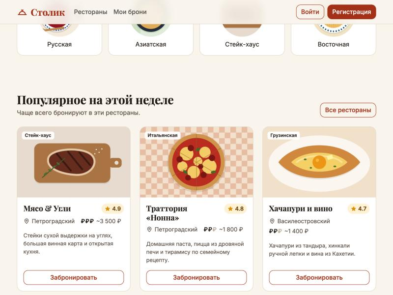
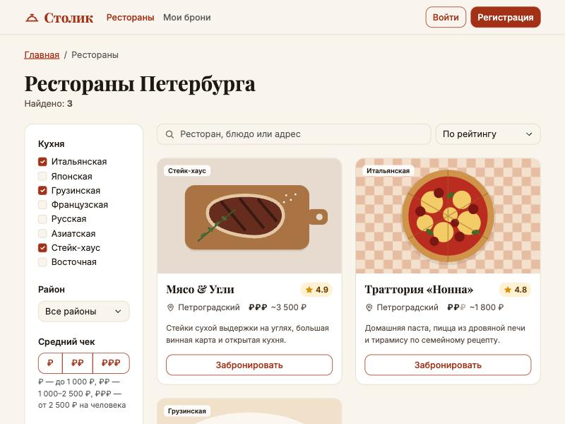
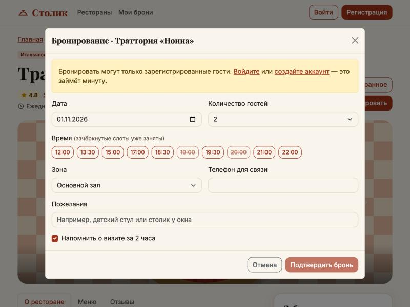
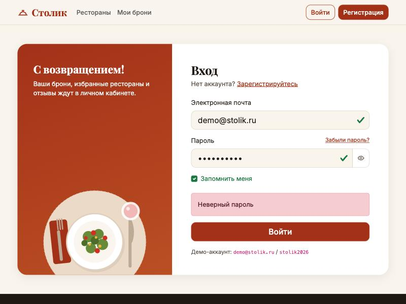
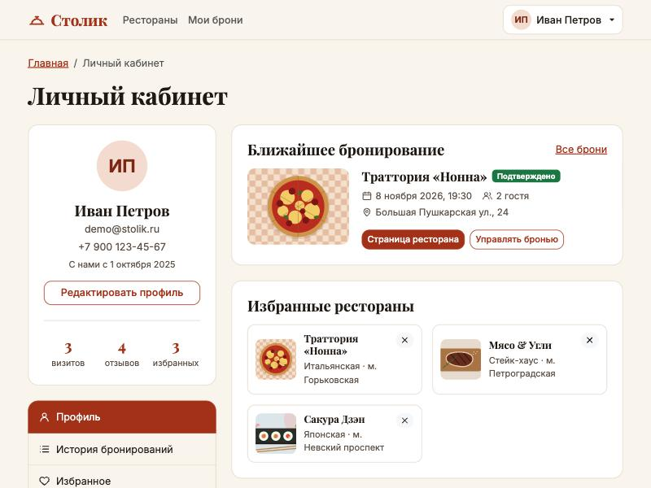
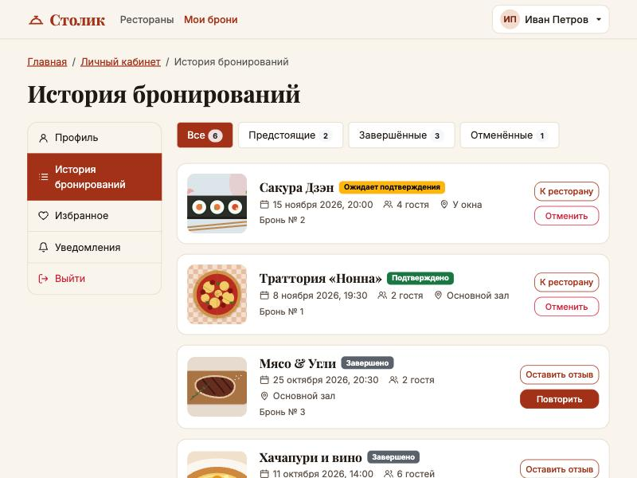
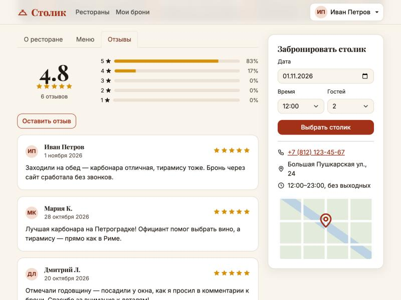
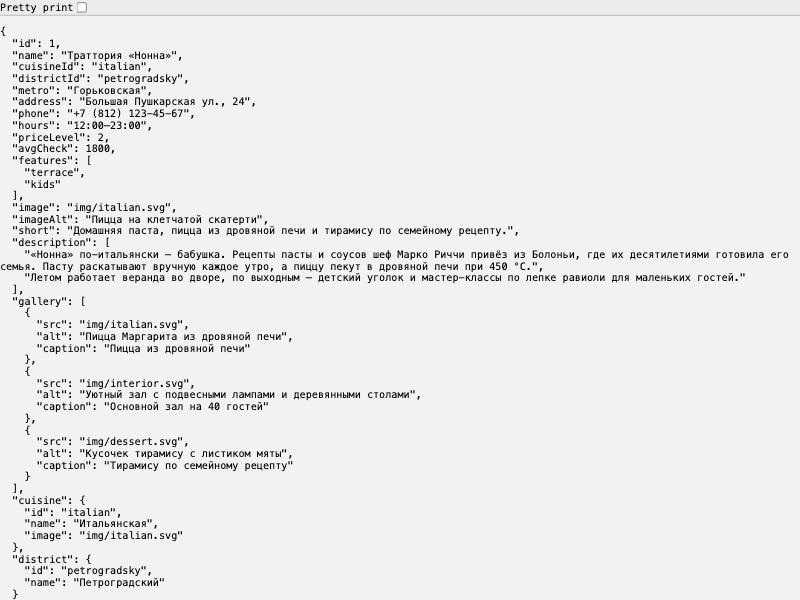

# Лабораторная работа 2. Взаимодействие с внешним API

**Студент:** Субботин Александр, поток K3439
**Вариант:** 1 — приложение для бронирования столиков в ресторанах («Столик»)

## Цель работы

Подключить сайт из ЛР1 к внешнему API средствами `fetch`. Реализовать моковое API на JSON-server и добавить в него авторизацию так же, как в примере с лекции (`json-server` + `json-server-auth`).

## Как запустить

Нужен Node.js (проверено на 24-й версии).

```bash
npm install
npm start
```

Затем откройте в браузере http://localhost:3000/index.html.

Команда `npm start` поднимает `json-server` с `db.json`, подключает `json-server-auth` как middleware и `routes.json` с правилами доступа. Тот же сервер раздаёт сайт из папки `public/`, поэтому страницы и API живут на одном адресе и CORS настраивать не нужно.

**Демо-аккаунт:** `demo@stolik.ru` / `stolik2026` — у него уже есть брони, избранное и отзывы. Можно и зарегистрироваться заново: новый пользователь сохранится в `db.json`.

## Структура

```
lab2/
├── package.json      # json-server 0.17 + json-server-auth, скрипт start
├── db.json           # «база данных» мокового API
├── routes.json       # правила доступа json-server-auth
└── public/           # сайт из ЛР1, переведённый на API
    ├── *.html
    ├── css/style.css
    ├── img/
    └── js/
        ├── api.js        # обёртка над fetch, токен, ошибки
        ├── main.js       # шапка, выход, тосты, валидация форм, requireAuth
        ├── ui.js         # отрисовка карточек, рейтинга, дат, экранирование
        ├── auth.js       # вход и регистрация
        ├── home.js       # главная
        ├── search.js     # поиск с фильтрами
        ├── restaurant.js # страница ресторана, отзывы, избранное, бронь
        ├── profile.js    # личный кабинет
        └── bookings.js   # история бронирований
```

## Моковое API

### Ресурсы в `db.json`

| Ресурс | Что хранит |
|---|---|
| `users` | пользователи (пароль хранится в виде bcrypt-хеша, его делает json-server-auth) |
| `restaurants` | 9 ресторанов: `cuisineId`, `districtId`, адрес, телефон, часы, ценовой уровень, средний чек, особенности, галерея, описание |
| `cuisines`, `districts`, `features` | справочники для фильтров |
| `menu` | блюда, привязаны к ресторану через `restaurantId` |
| `reviews` | отзывы (`restaurantId`, `userId`, оценка, текст, дата) |
| `bookings` | брони пользователя (`userId`, `restaurantId`, дата, время, гости, зона, статус) |
| `favorites` | избранные рестораны (`userId`, `restaurantId`) |

### Правила доступа (`routes.json`)

| Ресурс | Правило | Что значит |
|---|---|---|
| `restaurants`, `menu`, `cuisines`, `districts`, `features` | `444` | только чтение, для всех |
| `reviews` | `644` | читать могут все, писать — только вошедшие (от своего `userId`) |
| `bookings`, `favorites`, `users` | `600` | читать и менять может только владелец |

Без токена закрытые ресурсы отвечают `401 Missing authorization header`. С токеном `GET /bookings` возвращает только брони владельца.

### Какие запросы делает сайт

| Страница | Запросы |
|---|---|
| Регистрация / вход | `POST /register`, `POST /login` → `accessToken` и `user` сохраняются в `localStorage` |
| Главная | `GET /cuisines`, `GET /districts`, `GET /restaurants?_expand=cuisine&_expand=district&_embed=reviews` (топ-3 по рейтингу) |
| Поиск | справочники + `GET /restaurants?cuisineId=…&districtId=…&priceLevel=…&q=…&_sort=avgCheck&_order=asc&_expand=…&_embed=reviews` |
| Ресторан | `GET /restaurants/:id?_expand=cuisine&_expand=district&_embed=menu&_embed=reviews`, `POST /reviews`, `GET/POST/DELETE /favorites`, `POST /bookings` |
| Личный кабинет | `GET /users/:id`, `GET /bookings?userId=…&_expand=restaurant`, `GET /reviews?userId=…`, `GET /favorites?userId=…&_expand=restaurant`, `PATCH /users/:id`, `DELETE /favorites/:id` |
| История броней | `GET /bookings?userId=…&_expand=restaurant&_sort=date&_order=desc`, `PATCH /bookings/:id` (`status: cancelled`) |

## Авторизация на клиенте

- После `/login` или `/register` токен и пользователь сохраняются в `localStorage` (`accessToken`, `user`), как в примере с лекции. Пароль и хеш пароля в браузере не хранятся.
- `api.js` добавляет к каждому запросу заголовок `Authorization: Bearer <token>`.
- Ошибки json-server-auth переводятся на русский и показываются прямо в форме: «Неверный пароль», «Пользователь с такой почтой уже зарегистрирован» и т. д.
- Токен json-server-auth живёт час. Если сервер ответил `401` на запрос с токеном, пользователь разлогинивается и попадает на вход.
- Личный кабинет и история броней закрыты: без токена они отправляют на `login.html?next=…`, а после входа возвращают обратно. Параметр `next` принимает только локальные `*.html`, чтобы ссылкой нельзя было увести на чужой сайт.
- Гость видит каталог и отзывы. При попытке забронировать или оставить отзыв он получает подсказку войти.

## Что ещё сделано

- **Фильтрация на сервере.** Кухню, район, ценовой уровень и текстовый поиск выполняет json-server через query-параметры; сортировка по цене — через `_sort`/`_order`. Рейтинг ресторана считается по его отзывам, поэтому фильтр и сортировка по рейтингу, а также фильтр по особенностям работают на клиенте.
- **Фильтры в адресной строке.** Они синхронизируются с URL, так что ссылкой на поиск можно поделиться.
- **Задержка текстового поиска.** Запрос уходит через 350 мс после последнего ввода, а ответы на устаревшие запросы игнорируются.
- **Пересчёт рейтинга.** После нового отзыва рейтинг и распределение оценок пересчитываются сразу, без перезагрузки.
- **Защита от XSS.** Всё, что ввёл пользователь (отзывы, имена, пожелания к брони), экранируется перед вставкой в HTML.
- **Состояния загрузки.** У каждого запроса есть индикатор загрузки и сообщение об ошибке, если сервер недоступен.

### Подводные камни json-server, найденные при отладке

1. Сортировка по нескольким полям (`_sort=date,time`) ломает проверку доступа json-server-auth — сервер отвечает `401`. Поэтому сервер сортирует только по дате, а время досортировывается на клиенте.
2. При любом `DELETE` json-server проверяет все поля `*Id` во всех коллекциях. На `userId: null` он падал с ошибкой 500, а записи со ссылкой на несуществующего пользователя удалил бы. Поэтому у анонимных отзывов в сиде поля `userId` нет совсем.

## Скриншоты

| | |
|---|---|
|  Популярные рестораны из API |  Поиск: кухни из URL + рейтинг ≥ 4.5 |
|  Гость не может забронировать |  Ошибка от json-server-auth |
|  Личный кабинет (данные из API) |  История броней пользователя |
|  Новый отзыв через `POST /reviews` |  Ответ `GET /restaurants/1?_expand=…` |

## Вывод

Сайт из ЛР1 переведён на моковое API: каталог, меню, отзывы, бронирования, избранное и профиль загружаются и сохраняются через `fetch`. Авторизация построена на json-server-auth: регистрация, вход, JWT-токен в заголовке и правила доступа к ресурсам. Закрытые страницы недоступны без входа, ошибки сервера показываются пользователю.
